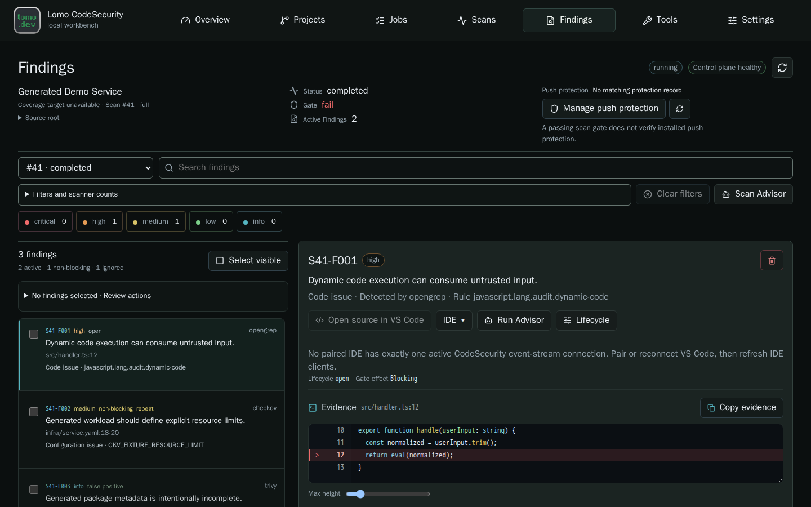

# Lomo CodeSecurity

Local security scanning, finding review and checks before you push.

[](https://github.com/lomolabs/lomo-codesecurity/actions/workflows/tests.yml)
[](https://github.com/lomolabs/lomo-codesecurity/actions/workflows/security.yml)
[Apache-2.0](LICENSE)

[Quickstart](#quickstart) · [Daily workflow](docs/GUI_FIRST_WORKFLOW.md) · [Scanners](docs/SCANNER_TOOLS.md) · [Release status](docs/RELEASE_STATUS.md) · [Security](SECURITY.md)

CodeSecurity brings scanner results into one local workbench and your existing
VS Code profile. Inspect a finding and its source, record a review decision,
and check the committed history you intend to push. Ordinary scans do not
invoke AI. An optional Advisor helps explain findings without deciding the gate.

**0.1 source preview.** Build the backend and extension from source. Mac ARM64
and Ubuntu AMD64 have scoped functional acceptance; Fedora qualification is
partial, and Windows native and Remote WSL remain experimental. Marketplace
publication is pending. See [tested scope and known issues](docs/RELEASE_STATUS.md).



*The Findings view, using synthetic demonstration data from the browser tests.*

## What you can do

| Task | In the workbench |
| --- | --- |
| Scan code and dependencies | Run eight pinned external tools for application security, secrets, infrastructure checks, vulnerabilities and an SBOM. [Tool roles and limits](docs/SCANNER_TOOLS.md). |
| Review findings | Filter results, inspect bounded code evidence, open the exact source in VS Code and record reasoned lifecycle decisions. |
| Manage repositories | Select independent repositories, authorize narrow source roots and keep each project's scans and policy separate. |
| Check outgoing history | Apply protection deliberately to a clone. Completed evidence and the configured policy determine whether its push proceeds. |
| Understand a result | Use optional local Ollama, or explicitly authorize a remote Advisor with a single-finding disclosure preview. Advice never changes the deterministic gate. |

The external tools are Trivy, Gitleaks, OpenGrep, Bearer, Grype, Checkov,
TruffleHog and Syft. They retain their own licenses. Internal heuristic scanners
are optional and disabled by default.

## Quickstart

### 1. Start the backend

First follow [platform setup](docs/PLATFORM_SETUP.md). You need Python 3.12+,
Git, Make and a local Linux Docker engine with Compose and Buildx. A fresh build
requires network access and **32 GiB free on both source/state and Docker build
storage**; a restart with matching images has a separate 2 GiB floor. These are
admission floors, not measured steady-state usage.

On macOS or Linux:

```sh
git clone https://github.com/lomolabs/lomo-codesecurity.git
cd lomo-codesecurity
python3 scripts/start-lomo.py --check --json
python3 scripts/start-lomo.py
```

`--check` never downloads its storage-probe image. On a pristine engine,
`engine_storage_probe_missing` means normal startup needs to obtain that pinned
dependency first. For other failed checks, follow the report's recovery guidance.

The launcher builds and starts the backend. It does not install prerequisites,
change your Docker configuration, install an extension or open an editor.
Repeat the startup command to retain installation data and pairing and reuse
matching builds. Keep the checkout separate from the repositories being scanned.

The default address is `http://127.0.0.1:8080`.
[Choose another local port](docs/SOURCE_STARTUP.md#use-a-different-local-port)
if it is already in use.

Windows uses a WSL2 backend. Follow the separate
[Windows startup guide](docs/WINDOWS_SOURCE_STARTUP.md); native Windows VS Code
and Remote WSL are different extension hosts.

### 2. Add CodeSecurity to VS Code

Install the [documented Node.js/npm prerequisites](docs/PLATFORM_SETUP.md#build-the-preview-extension), then build the preview extension:

```sh
make vscode-package
```

In your existing VS Code profile, run **Extensions: Install from VSIX…** and
select `.kodesec-test/vscode/code-security-0.1.0.vsix`. Open your project and run
**CodeSecurity: Get Started**. The extension ID is `lomo-dev.code-security`.
Installing it does not start the backend or replace your other extensions.

Review Workspace Trust normally. The first eligible profile uses the
installation's first-owner connection flow. Additional profiles need owner
approval in **Settings → Trusted access → IDE access**, using the displayed
verification code and profile name. No access secret needs to be pasted into
the editor. [Browser-only setup](docs/SOURCE_STARTUP.md#explicit-editor-and-browser-choices)
is also available.

### 3. Reach your first finding

1. **Authorize the source.** Select the repository and review its narrow source
   authorization. Selecting a child never grants its parent or siblings.
2. **Prepare scanners.** Choose **Tools → Prepare all scanners**. The separate
   updater verifies data and rules without access to your source. Wait for the
   enabled scanners to be ready.
3. **Scan and review.** Scan the repository, folder or supported file. Use
   Findings, Problems and **Open Finding in Web** to inspect results and coverage.
   A completed scan can correctly fail its policy gate.
4. **Choose protection.** Review thresholds, then use **Protect Pushes…** to
   approve and apply protection to that clone. **Check Outgoing Commits…**
   checks the committed history you plan to push. A workspace scan alone does
   not install a hook.

The [workflow guide](docs/GUI_FIRST_WORKFLOW.md) explains the controls in detail.
Incomplete, cancelled, failed or stale evidence cannot authorize a protected
push. Local commits remain available. Hooks can be bypassed with `--no-verify`
or another clone; use remote branch controls for unavoidable enforcement.

## Updates and data freshness

The preview maintains scanner data through reviewed source updates. When
definitions expire, obtain refreshed source, run normal startup to rebuild
changed inputs, and prepare again. Downloading an expired definition again
does not renew it. [Preparation and expiry](docs/SCANNER_TOOLS.md).

Preserve the installation's owner-private runtime state and Docker named volumes
when updating. [Startup and recovery](docs/SOURCE_STARTUP.md) and
[data persistence](docs/PERSISTENCE.md) describe what to keep. Backup/restore
helpers are not a validated disaster-recovery facility.

## Privacy and limits

The default origin is loopback-only. Source access uses narrowly authorized
read-only mounts or bounded snapshots. Runtime scanners operate offline against
validated data; redacted findings and bounded snippets persist locally. Optional
remote Advisor requests require separate authorization and a disclosure preview.

CodeSecurity is not a sandbox for hostile repositories. A passing scan does not
guarantee secure code, and redaction cannot recognize every secret. Read the
[security model](SECURITY.md) and [platform limits](docs/RELEASE_STATUS.md).

## Help and development

For startup or runtime trouble, run `make support-bundle` in the backend checkout.
It collects bounded local diagnostics without uploading anything or restarting
services. [Review the bundle before sharing](docs/MONITORING.md#local-bug-report-bundle).
Use [Issues](https://github.com/lomolabs/lomo-codesecurity/issues) for ordinary
bugs and [private vulnerability reporting](https://github.com/lomolabs/lomo-codesecurity/security/advisories/new)
for security reports.

Start contributions with [CONTRIBUTING.md](CONTRIBUTING.md), the
[development guide](docs/DEVELOPMENT.md) and [architecture](docs/ARCHITECTURE.md).
The [CI guide](.github/WORKFLOWS.md) explains runner requirements, retained
diagnostics and the intentional vulnerable test fixtures.

## License

Project-authored source uses [Apache-2.0](LICENSE). Third-party engines,
dependencies, rules and fixtures retain their own terms. See the
[scanner license index](services/scanner/licenses/README.md) and the Web build's
generated `THIRD_PARTY_LICENSES.md`. These notices do not establish rights
clearance for future distributions or grant trademark rights.
