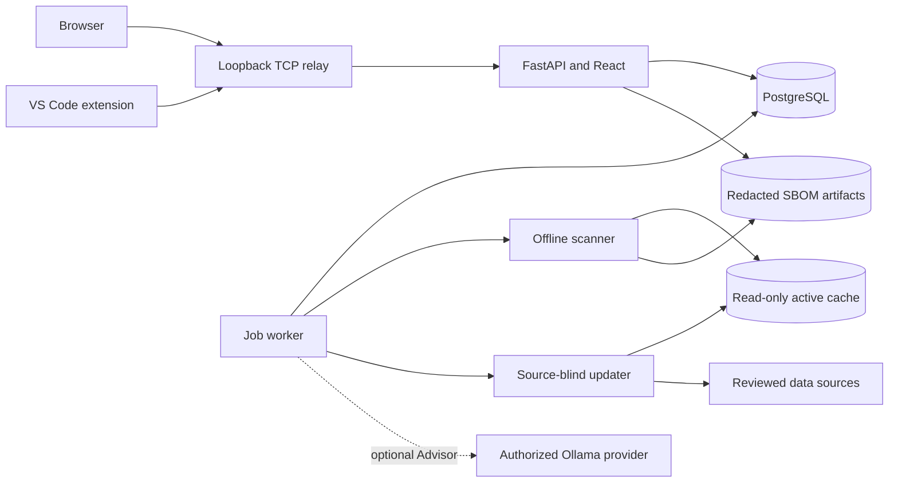

# Architecture

Lomo CodeSecurity is a local AppSec workbench built around Docker Compose. A
FastAPI service serves the compiled React dashboard and the API used by the
VS Code extension. PostgreSQL stores application state; a separate worker owns
durable jobs and invokes the scanner and optional Advisor.

## Services and boundaries

The core exposes one loopback address, `http://127.0.0.1:8080`. Only the
unprivileged TCP relay publishes that host port. The credential-bearing API,
database and scanner use internal container networks. The relay has no
persistent mounts or runtime secret configuration. The API has no Docker socket.
Applying host changes remains an explicit operator action.

Monitoring, a local Git proxy and database administration are optional Compose
profiles, off by default. They do not change the core API's authority.

## Source and identity

Browser sessions and editor capabilities are independently revocable. A
pristine installation supports one first-owner connection; later editor
profiles require owner approval. Workspace Trust, IDE membership, selected
repositories, source authorization and Git protection are distinct decisions.

POSIX/Remote WSL source is mounted read-only beneath explicitly authorized narrow
roots. Native Windows uses bounded sealed snapshots for supported local-drive
sources. Paths, content digests, scope and repository identity are checked before
use. Opening a parent directory does not authorize its children automatically.

Generated runtime secrets stay outside the source checkout. See the
[security policy](../SECURITY.md) for trust assumptions and exact boundaries.

## Scanning and persistence

The worker claims persisted jobs with leases, heartbeats and attempt fencing.
Jobs expose progress, cancellation and supported retry actions. Each repository
has its own scan and result; one repository's pass cannot cover another.

The scanner integrates Trivy, Gitleaks, OpenGrep, Bearer, Grype, Checkov,
TruffleHog and Syft. Internal lightweight rules are explicitly identified as
limited coverage. Runtime scanners use validated offline data. A separate
source-blind updater downloads only reviewed data components, validates them,
then atomically selects a complete cache generation.

Scanner output becomes bounded, normalized and redacted findings. The worker
validates paged results and commits them to PostgreSQL before acknowledging
scanner cleanup. Raw tool output is temporary. Only supported, bounded,
redacted SBOMs are persisted as downloadable scanner artifacts.

PostgreSQL and Docker named volumes retain projects, findings, jobs, policies,
artifacts and scanner data. Browser navigation is not the owner of a job's
lifetime. See [persistence](PERSISTENCE.md) and [scanner maintenance](SCANNER_TOOLS.md).
The current recovery design does not establish full crash or disaster-recovery
qualification.

## Findings, gates and protection

Finding lists and details use bounded pages and revision checks. Stale
client state is reconciled instead of silently overwriting a newer finding.
Finding dispositions require the applicable review and affect gate evaluation
without rewriting the underlying scan coverage.

Only a completed scan can pass the deterministic gate. Partial, failed or
cancelled evidence stays incomplete, even if the findings collected so far
would satisfy the project's thresholds.

Git protection is a separately approved repository-local hook. It checks
outgoing immutable committed content, including earlier outgoing history, and
binds a decision to current policy and scanner evidence. A working-tree scan
is not a substitute. See [Git push protection](GIT_PUSH_PROTECTION.md).

## Optional Advisor

The worker owns Advisor requests. Local Ollama is optional, and normal scans
do not invoke AI. Remote routes require exact provider authorization and a
fresh, single-finding disclosure confirmation. Advice never changes finding
lifecycle or gate decisions automatically.

## Source map

| Path | Responsibility |
| --- | --- |
| `apps/api/` | API, persistence model and job worker |
| `apps/web/` | React dashboard |
| `services/scanner/` | Scanner adapters, data contracts and engine notices |
| `extensions/vscode/` | Editor integration and repository-local protection helper |
| `scripts/` | Host startup, source authorization and maintenance tools |
| `docs/` | Setup, operation and contributor guides |

See [development](DEVELOPMENT.md) for public checks and
[release status](RELEASE_STATUS.md) for the limits of this preview.
